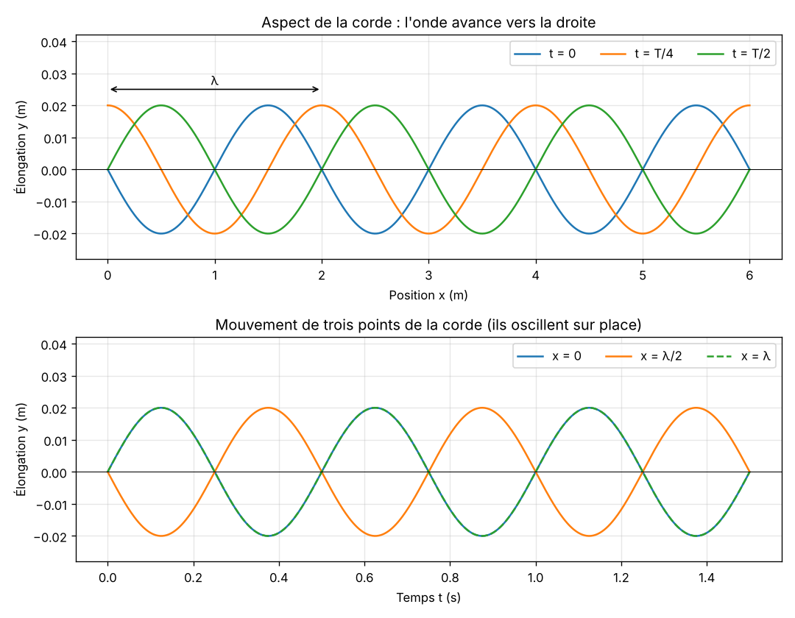

# Onde progressive sinusoïdale (Python)

Petit projet personnel réalisé pour mettre en pratique le cours
d'**Ondes et vibrations** (L2) : la propagation d'une **onde progressive
sinusoïdale** le long d'une corde.

## Ce que fait le programme

1. Calcule les caractéristiques de l'onde : **période T**, **longueur d'onde λ**,
   **pulsation ω** et **nombre d'onde k**, puis vérifie que `ω / k = v`.
2. Calcule le **déphasage** entre deux points de la corde et indique s'ils
   vibrent **en phase** ou **en opposition de phase**.
3. Trace **l'aspect de la corde** à t = 0, T/4 et T/2 : on voit l'onde avancer
   vers la droite (périodicité **spatiale** λ).
4. Trace **le mouvement de trois points** de la corde : chaque point oscille
   sur place (périodicité **temporelle** T).
5. Enregistre les graphiques dans `resultat.png`.

## Lancer le projet

```bash
pip install -r requirements.txt
python onde.py
```

Sortie console :

```
Période           T      = 0.500 s
Longueur d'onde   lambda = 2.000 m
Pulsation         w      = 12.566 rad/s
Nombre d'onde     k      = 3.142 rad/m
Vérification      w / k  = 4.000 m/s (= v)

Points séparés de 1.00 m : déphasage = 1π rad -> en opposition de phase
Points séparés de 2.00 m : déphasage = 2π rad -> en phase
```

## Résultat



## Notions utilisées

- Équation de l'onde : `y(x, t) = A·sin(ωt − kx)`
- Pulsation `ω = 2πf`, période `T = 1/f`
- Nombre d'onde `k = 2π/λ`
- Vitesse de propagation `v = λ·f = ω/k`
- Déphasage entre deux points distants de d : `Δφ = 2π·d/λ`
  - d = λ/2 → opposition de phase
  - d = λ → en phase

## Modifier les paramètres

Au début du fichier `onde.py` :

```python
A = 0.02     # amplitude (m)
f = 2.0      # fréquence (Hz)
v = 4.0      # vitesse de propagation (m/s)
```

## Pistes d'amélioration

- Animer la propagation de l'onde avec `matplotlib.animation`
- Superposer deux ondes de sens opposés pour obtenir une **onde stationnaire**
- Appliquer les formules aux ondes radio (ex. Wi-Fi à 2,4 GHz : λ ≈ 12,5 cm)

---
Auteur : **Mohamed Islam SAIMI** — Étudiant en Licence 2 Télécommunications
